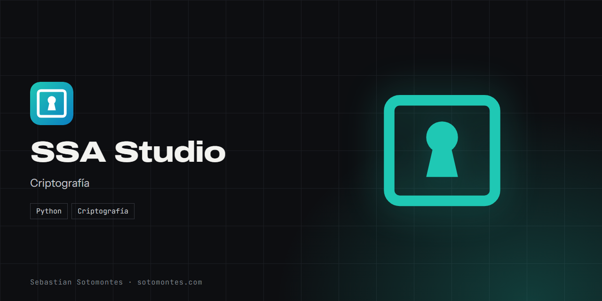
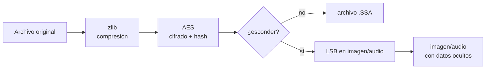

Cifrado AES, esteganografía y un formato propio .SSA para esconder y proteger archivos dentro de imágenes y audio.

<a href="https://sotomontes.com/#ssa-studio"><b>Ver en sotomontes.com</b></a> · <a href="#cómo-se-usa">Cómo se usa</a> · <a href="#cómo-funciona-por-dentro">Cómo funciona</a> · <a href="#novedades">Novedades</a>

| Ficha técnica | |
|---|---|
| **Autor** | Sebastian Sotomontes |
| **Tipo** | Criptografía |
| **Plataforma** | Windows, con Python |
| **Versión** | 2.1 |
| **Estado** | Estable |
| **Stack** | Python · Criptografía |
| **Código** | Privado. Esta página es solo una presentación. |

---

## Qué es

SSA Studio protege archivos combinando tres capas: compresión, cifrado con contraseña y, si quieres, esteganografía para esconderlos dentro de una imagen o un audio sin cambio perceptible. El resultado también se puede guardar en su formato propio `.SSA`.

## Novedades

- Formato .SSA con verificación de integridad.

## Cómo se usa

1. Abre SSA Studio y elige el archivo que quieres proteger.
2. Escribe una contraseña.
3. Elige la salida: un archivo `.SSA` o esconderlo dentro de una imagen PNG o BMP o de un audio WAV.
4. Guarda el resultado.
5. Para recuperarlo, abre el archivo o la imagen, escribe la contraseña y extrae el contenido.

## Funciones

- **Cifrado AES** con contraseña y compresión.
- **Esteganografía** en imágenes y audio, sin cambio perceptible.
- **Formato `.SSA`** propio y autodescriptivo.
- **Verificación de integridad** que detecta manipulaciones.
- **Interfaz gráfica** sencilla.

## Detalles

- Comprime antes de cifrar para que ocupe menos.
- Un hash detecta manipulaciones o una contraseña incorrecta.

## Privacidad y seguridad

Está pensado para proteger tu propia información. Úsalo de forma responsable y legal.

## Cómo funciona por dentro

### Cómo funciona

El flujo tiene tres capas que se pueden combinar:

1. **Comprimir** el contenido (zlib) para que ocupe menos.
2. **Cifrar** con **AES** usando una contraseña; se guarda junto a un **hash** para verificar la integridad.
3. **Empaquetar** en el formato propio **`.SSA`** (*Steganography Secure Archive*) o, opcionalmente, **esconder**
   ese paquete dentro de una imagen (PNG/BMP) o un audio (WAV) con la técnica **LSB** (se modifican los bits menos
   significativos, imperceptibles a la vista o al oído).

Para recuperar el archivo se hace el camino inverso: se extrae de la imagen/audio, se descifra con la contraseña
y se descomprime.

### Estructura

| Archivo | Contenido |
|---|---|
| `ssa_core.py` | Motor: compresión, cifrado AES y lectura/escritura del formato `.SSA` |
| `ssa_stego.py` | Esteganografía LSB en imágenes y audio |
| `ssa_studio.py` | Interfaz gráfica |
| `run.py` | Lanzador |

### Tecnologías

- **Python 3** + **Tkinter** (GUI).
- **pycryptodome** (AES) y **Pillow** (imágenes); zlib y hashlib de la librería estándar.

---

© 2026 Sebastian Sotomontes. Todos los derechos reservados.
